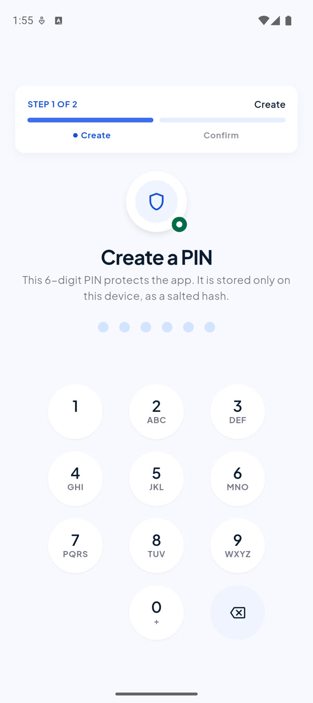
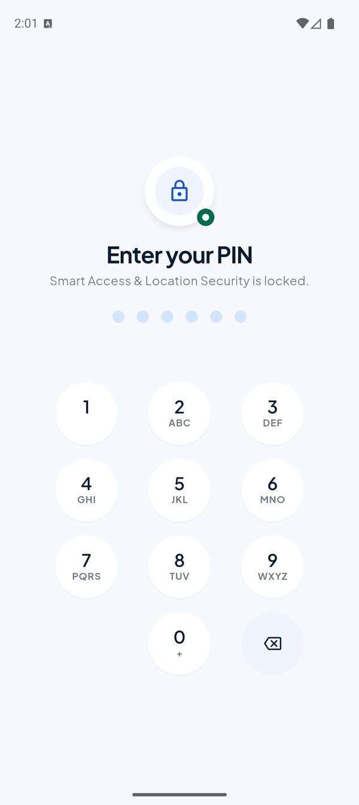
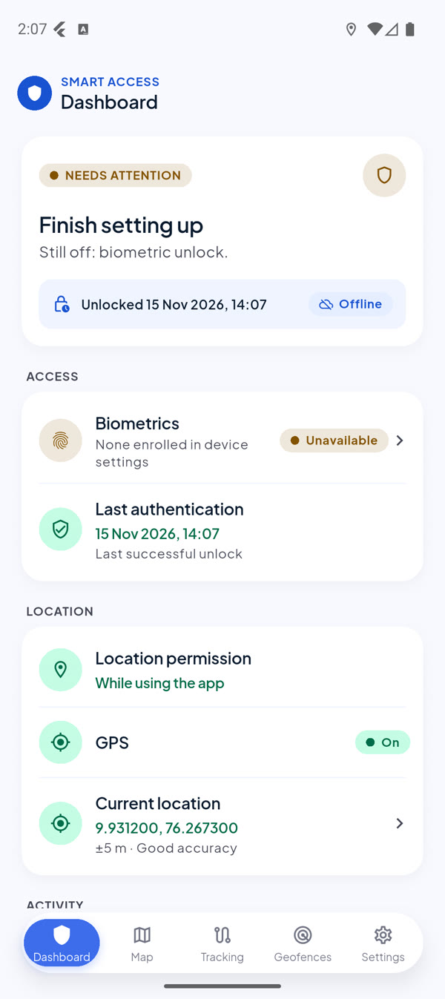
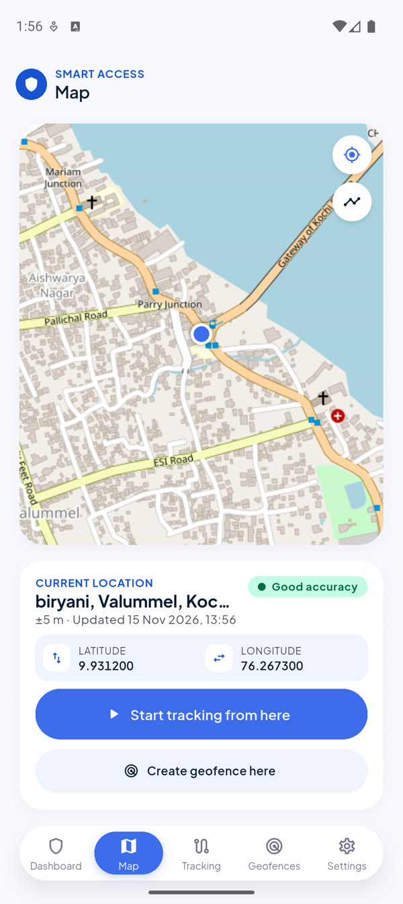
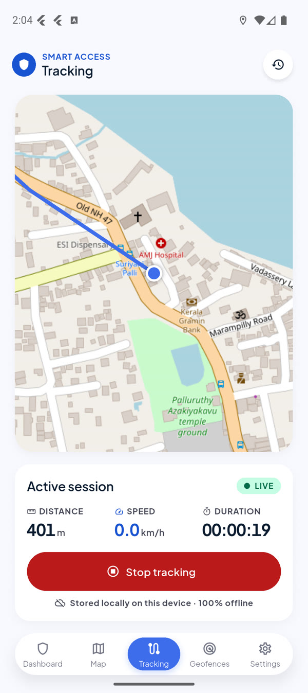
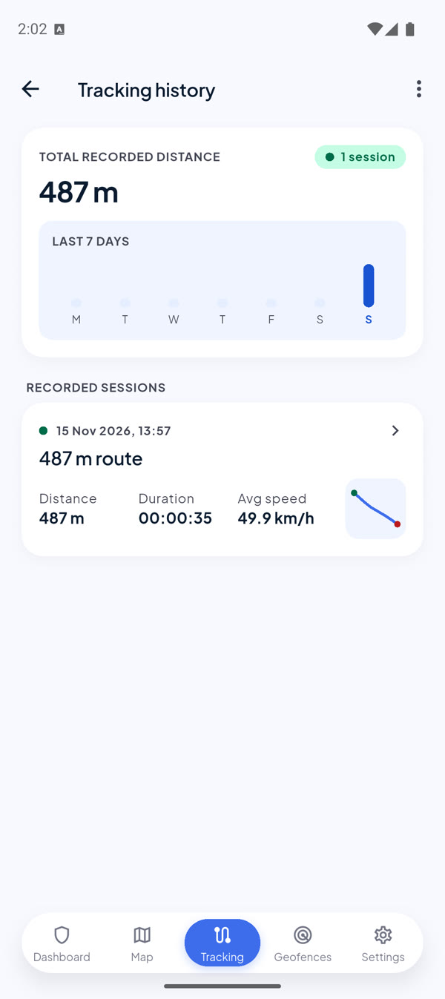
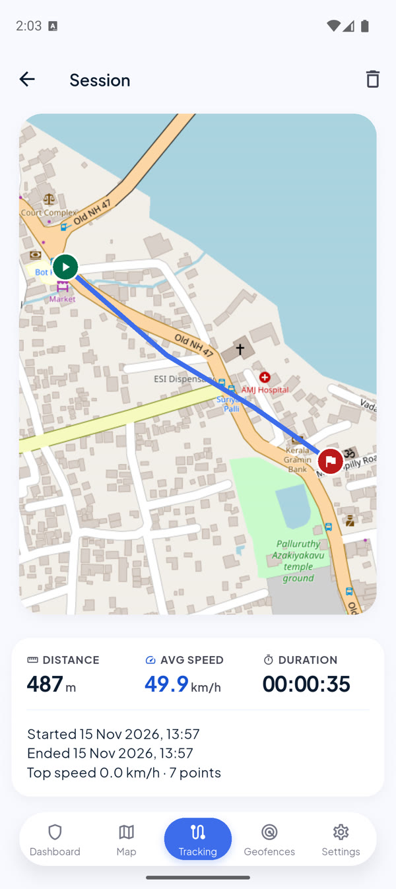
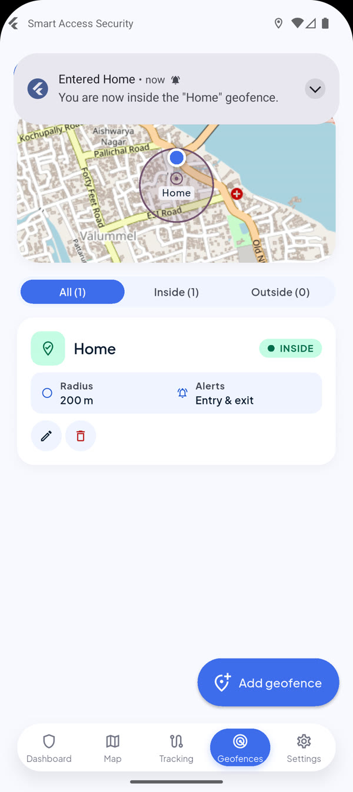
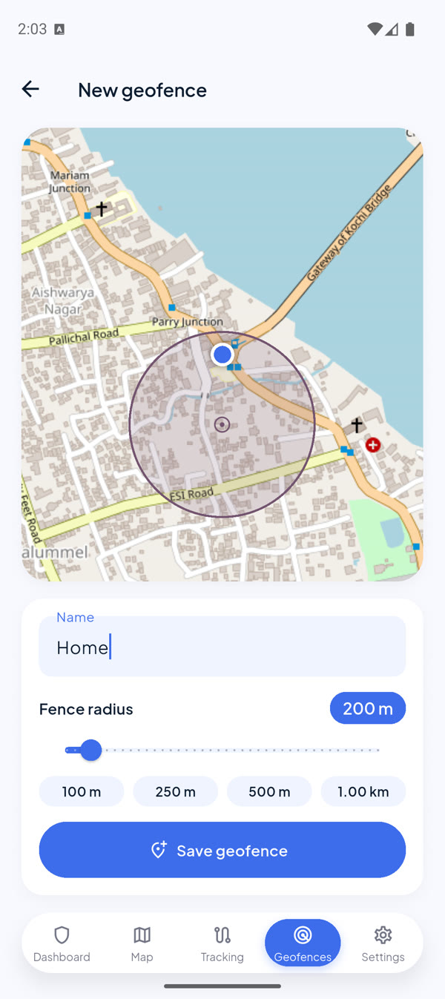
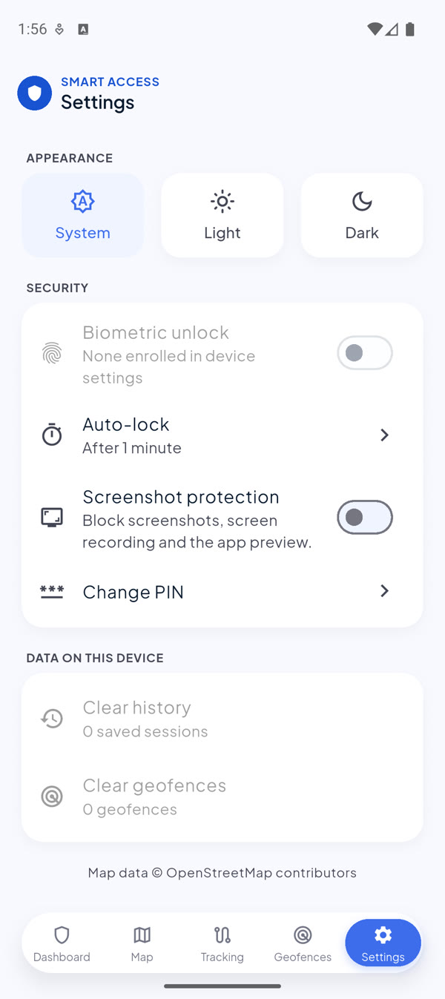

# Smart Access & Location Security

An offline Flutter app for Android and iOS that combines an app lock (PIN and
biometrics) with location features: a live map, tracking sessions, geofencing
and a security dashboard.

There is no backend and no REST API. Everything is stored on the device. The
only network use is downloading OpenStreetMap tiles and the platform's
reverse geocoder.

## Features

| Area | What it does |
|---|---|
| App lock | 6-digit PIN set on first launch, biometric unlock with PIN fallback, wrong-PIN throttling, auto-lock after background time or inactivity |
| Location | Permission explanation before the system dialog, latitude / longitude / accuracy (good, fair, poor), address, map with refresh and recenter |
| Tracking | Start / stop sessions, live polyline, distance, speed, duration, background tracking, mock-location warning and notification |
| History | Saved sessions, detail screen with the route, export to CSV / JSON, clear history |
| Geofencing | Create by tapping or long-pressing the map, name and radius (50–2000 m), edit, delete, entry / exit notifications |
| Dashboard | Cards for biometrics, permission, GPS, current location, tracking, geofences and last authentication |
| Settings | Theme, auto-lock duration, biometric toggle, change PIN, screenshot protection, clear data |

## Setup

Requirements: Flutter 3.38 or newer (Dart 3.10), Android SDK, and Xcode 15+
on macOS for iOS.

```bash
flutter pub get
flutter run
```

Generated files (`*.g.dart`, `*.freezed.dart`) are committed, so the project
builds without a code generation step. After changing a provider or a model,
regenerate them:

```bash
dart run build_runner build --force-jit
```

`--force-jit` is needed because some plugins use native build hooks, which
build_runner's default ahead-of-time mode does not support.

To run every check in one go (generate, fix, format, analyze, test):

```bash
bash tool/check.sh
```

### Build the Android APK

```bash
flutter build apk --release
```

The APK is written to `build/app/outputs/flutter-apk/app-release.apk`. The
release build is signed with the debug key so it works out of the box;
replace `signingConfig` in `android/app/build.gradle.kts` before publishing.

### Run on iOS

```bash
cd ios && pod install && cd ..
flutter run -d <device-id>
```

Open `ios/Runner.xcworkspace` in Xcode once to select your signing team.
Face ID and background location need a real device.

## Architecture

Feature-based Clean Architecture. Each feature has three layers, and
dependencies only point inwards (presentation → domain ← data).

```
lib/
  main.dart, bootstrap.dart, app.dart
  core/
    constants/  errors/  utils/        shared values, Failure types, formatters, clock
    storage/                           Hive JSON store, secure store
    router/                            GoRouter, lock redirect guard, app shell
    notifications/  security/          local notifications, screenshot protection
    theme/  widgets/                   Material 3 theme, reusable widgets
  features/
    auth/  location/  tracking/  geofence/  settings/  dashboard/
      domain/        entities, repository interfaces, pure services
      data/          repository implementations (Hive, plugins)
      presentation/  controllers (Riverpod), screens, widgets
```

```
            presentation                    domain                     data
  ┌──────────────────────────┐   ┌─────────────────────────┐   ┌────────────────────┐
  │ Screens and widgets      │   │ Entities (freezed)      │   │ Repository impls   │
  │ Riverpod controllers     │──▶│ Repository interfaces   │◀──│ Hive, secure store │
  │ GoRouter                 │   │ Pure services and rules │   │ geolocator, etc.   │
  └──────────────────────────┘   └─────────────────────────┘   └────────────────────┘
```

**Domain** is plain Dart. The rules that matter live here as small classes
that are unit tested without Flutter:

| Class | Responsibility |
|---|---|
| `PinThrottlePolicy`, `AuthService` | Wrong-PIN counting and lockouts |
| `AutoLockPolicy`, `AutoLockManager` | When the app must lock |
| `PositionStreamService` | The single position subscription |
| `TrackingCalculator` | Distance, speed, how a route grows |
| `GeofenceEvaluator` | Entry / exit detection |
| `SessionExporter` | CSV and JSON export |

**Data** implements the repository interfaces with plugins. Swapping a
plugin touches one file.

**Presentation** uses Riverpod code generation. Screens render `AsyncValue`
through one shared `AsyncValueView`, so every screen has the same loading,
error and empty states.

### Key design decisions

**One position stream.** `PositionStreamService` is the only code that
listens to the location plugin. Tracking, geofence monitoring and the map
call `acquire` / `release` and listen to its shared stream. The platform
subscription is opened for the first consumer, closed after the last, and
start / stop requests are queued, so two subscriptions can never be open at
once, whatever the lifecycle or navigation does.

**Lock as a router guard.** `AppLock` holds the lock state. GoRouter's
redirect (`resolveLockRedirect`, a pure function) sends every route to
`/lock` while locked and returns to the original route after unlocking.

**PIN storage.** The PIN is never stored. A PBKDF2-HMAC-SHA256 hash with a
random 16-byte salt is kept in the Android Keystore / iOS Keychain through
`flutter_secure_storage`, and compared in constant time. Biometric data never
reaches the app: `local_auth` only reports success or failure.

**Geofence state.** Each geofence stores its last inside / outside state. A
notification is sent only when that state flips, and a 10 m exit margin stops
GPS noise at the boundary from firing repeatedly.

**Storage format.** Hive boxes hold JSON strings produced by the models'
`toJson`. There are no Hive type adapters to maintain, and the same JSON is
used for export.

### Routes

```
/setup-pin                 first launch
/lock                      whenever the app is locked
/location-permission       explanation before the system dialog
/dashboard
/map
/tracking  → /tracking/history → /tracking/history/:id
/geofences → /geofences/new, /geofences/:id/edit
/settings  → /settings/change-pin
```

## Packages

| Package | Why |
|---|---|
| `flutter_riverpod`, `riverpod_annotation`, `riverpod_generator` | State management with compile-time safe, generated providers |
| `go_router` | Declarative routing with a redirect guard for the lock screen |
| `local_auth` | Fingerprint / face unlock through the system prompt |
| `flutter_secure_storage` | Keystore / Keychain storage for the PIN hash and auth status |
| `cryptography` | PBKDF2 for hashing the PIN (pure Dart, no native code) |
| `geolocator` | Position, position stream, mock detection, foreground service |
| `geocoding` | Reverse geocoding with the platform geocoder (no API key) |
| `permission_handler` | Notification permission request |
| `flutter_map`, `latlong2` | Map with OpenStreetMap tiles, no API key |
| `hive_ce`, `hive_ce_flutter` | Fast local key-value storage for settings, geofences and sessions |
| `flutter_local_notifications` | Tracking, geofence and mock-location notifications |
| `path_provider`, `share_plus`, `csv` | Writing and sharing export files |
| `no_screenshot` | Screenshot and screen-recording protection |
| `freezed`, `json_serializable` | Immutable models with equality and JSON |
| `intl`, `uuid` | Date formatting and ids |
| `very_good_analysis` | Strict lint rules |
| `fake_async` | Fake time for timer tests |

Changes from the suggested list:

- **`cryptography` added.** The spec asks for a salted PIN hash but lists no
  hashing package.
- **`permission_handler` is pinned to 12.x.** Version 13 requires a newer
  Android Gradle plugin than Flutter 3.38 ships with.
- **`no_screenshot`** was chosen over `screen_protector`.

## Tests

```bash
flutter test
```

142 tests cover:

- repositories: settings, PIN, tracking sessions, geofences (real Hive in a
  temporary directory)
- geofence entry / exit logic and the geofence monitor
- distance and speed calculation
- auto-lock policy and timer logic (with fake time)
- PIN throttling, PIN rules, the lock redirect guard
- the single position subscription under rapid acquire / release
- export to CSV and JSON
- the mock-location alert (one notification when faking starts)
- widgets: lock screen (PIN, biometric success, cancel, lockout), the
  dashboard on a small phone and a tablet, and the navigation bar

## Known limitations

- **Map tiles need internet.** Tiles already viewed are cached by
  `flutter_map`, but new areas do not load offline. All other features work
  without a connection.
- **Addresses need internet on most devices.** The platform geocoder is used;
  offline it shows "Address not available".
- **Geofences are checked only while the app has positions.** That is while
  the app is open, or in the background during a tracking session. The app
  does not register OS-level geofences, so it will not wake up after being
  killed.
- **iOS background tracking** continues with "While Using" permission and the
  blue status-bar indicator, but iOS may pause updates when the device is
  stationary and stops them if the user force-quits the app.
- **Android battery optimisation** on some manufacturers can still stop the
  foreground service during long sessions.
- **Mock-location detection depends on the platform.** Android reports
  positions from a mock-location app. iOS reports software-simulated
  positions on iOS 15 and later only; hardware spoofers are not detected.
- **Screenshot protection is app-wide.** When enabled it covers every screen,
  including the lock screen, PIN screens and dashboard. It is off by default.
- **A forgotten PIN cannot be recovered.** There is no account; reinstalling
  the app resets it and deletes local data.
- **iOS has not been built.** The project was developed on Windows. The iOS
  configuration (Info.plist keys, background mode, Podfile) is in place but
  untested.
- **Auto-lock "Immediately"** applies to leaving the app. For idle time
  inside the app it uses a one-minute timeout.

## Screenshots

| PIN set-up | Lock screen | Dashboard | Map | Tracking |
|---|---|---|---|---|
|  |  |  |  |  |

| History | Session detail | Geofences | Geofence editor | Settings |
|---|---|---|---|---|
|  |  |  |  |  |

A screen-by-screen guide, including how to check each bonus feature, is in
[docs/Smart_Access_App_Guide.pdf](docs/Smart_Access_App_Guide.pdf).

## Screen recording

_Add a recording at `docs/recording.mp4` showing: PIN set-up, biometric
unlock, a tracking session, creating a geofence and an entry notification._
